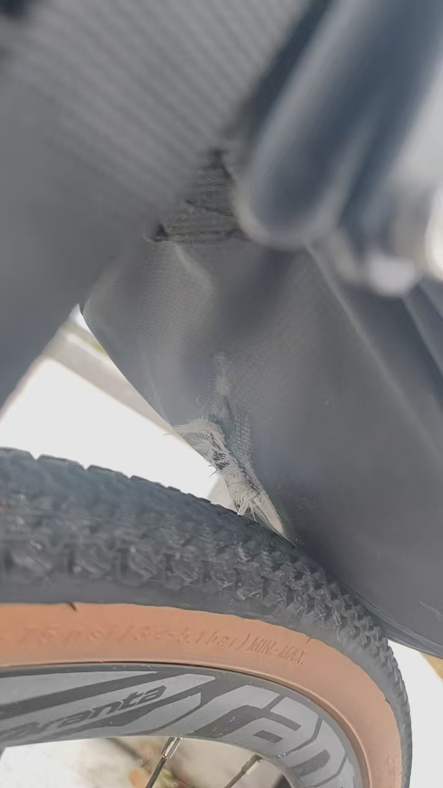
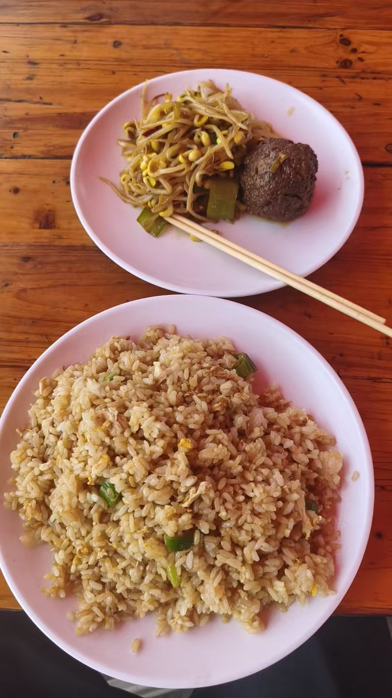
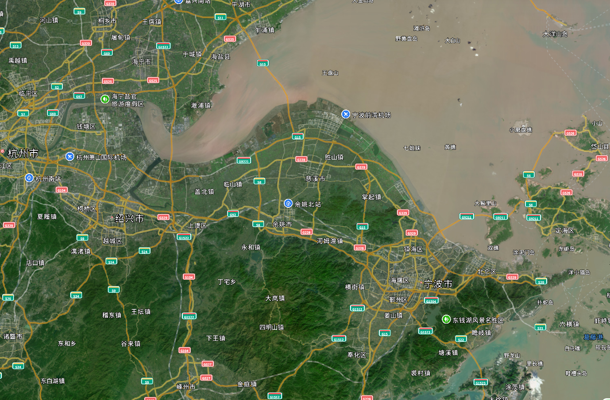
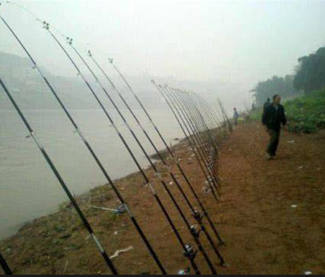
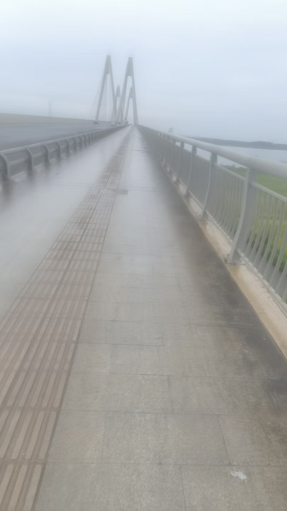
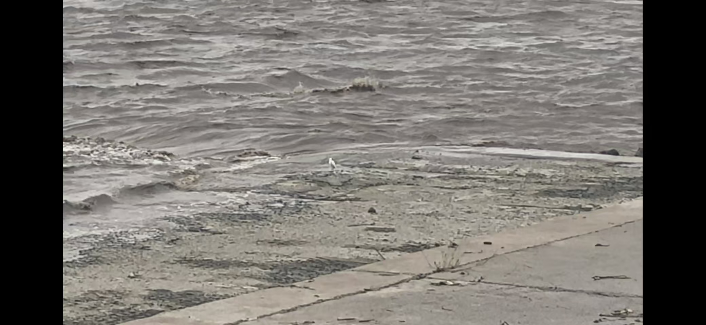
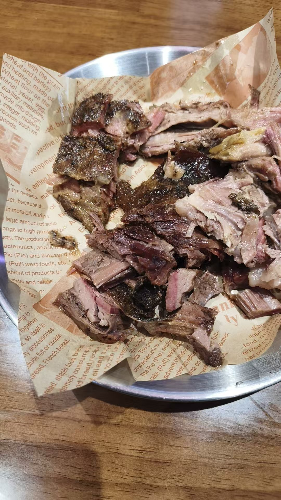

我的下半身湿透了，当我踩在踏板上的时候，我能感觉到肿胀脚趾与湿鞋垫被关在鞋里相互拥挤，发出滑腻的摩擦声，我的长裤紧贴着大腿，寒风嗖嗖地刺入膝盖，更糟糕的是，我的蛋蛋被车座子压迫着难以回缩，它现在又冷又痛......

9小时前，阳光明媚的滩涂边路空无一人，我骑着GT350侧头欣赏风光，栏杆外大片的灰色植被倾斜着点头，大概是芦苇之类的，滩涂面还没有涨潮，只有光秃秃的大片泥巴，我知道这底下有很多贝壳跟螃蟹，小时候爸妈带我去抓过，那螃蟹还夹过我！但我今天不是来抓螃蟹的，我正进行第一次长途骑行，而现在骑行开始后的第二小时，天气很好、滩涂很好、没有人的宽敞大路非常好，除了车座后面那个刚被磨破的尾包——它可是很重要的，我的衣服、补给、电子设备等行李统统都在里面，更关键的是，它昨天还是全新的！不过总的来讲，问题不大，一切都很好。

矿泉水很快就喝完了，再加上我有点担心尾包，就在一个公交车站停下整备。在调整尾包的时候，最靠外的补给掉了出来，不幸的是，当我忙完准备收拾，才发现一群蚂蚁已经顺着开裂的果皮攻占了果肉，这帮天杀的虫豸！强盗！这是私有的香蕉😡！不过短暂的惊怒后我还是选择饶恕它们，蕉死不可复生，要以德报怨。接下来的时间我一直在想，如果蚂蚁知道它们略过的光滑长方体，里面是热量巨大的士力架，会不会后悔选了根香蕉？我想肯定是会的，不过我现在又认为，它们的选择还是正确的，因为如果它们攻击士力架，那我可要攻击它们了。

附近是一片开发中的工业园区，周围的厂房设施崭新漂亮，但大多没有开放，所以接近饭点，我才发现最近的饭店居然在偏离路线的10km开外，但正所谓善有善报，手下留蚁的德行马上结出了善果，一辆餐车居然恰合时宜地出现在了路口，它是给附近的施工工人供餐的，这下不但有了午餐，而且还是高碳高钠的工地餐，这不正适合长途骑者吗？

运动过后，吃饱喝足，水群吹屁，快活似神仙，假期骑行是很好的，没有坏处的，我以前被社媒旅拍蛊惑，去过人挤人的景点，网红打卡点塞满了内存卡，但事后能回忆的就只有人潮的刺鼻汗臭与二手烟味。这次出发前我没做攻略，只是在高德地图缩放划拉了两分钟就确定了方向——南边是山,我不喜欢山，它们让我想到爬山和寺庙，我的膝盖不好，而且我讨厌香火味，北边是海，我不讨厌海，海边骑行大概是不坏的，那就去海吧。

我经过了一座长且拱的大桥，拱形桥最讨厌了，它有一半是上坡，上坡对骑行来讲是很痛苦的，短短半段桥就榨干了我的大腿，连带着胸口咚咚直响，帝王引擎启动了，但熬过了上坡，我就能享受下行放坡的滋味了，我能趴在车架上，听花鼓哗哗作响，也终于有功夫注意桥边的钓鱼佬，他们零零散散地分布，附近的围栏齐刷刷地架着五六根鱼竿，我第一次见到这种一人多竿的钓鱼方式，鱼线不会缠在一起吗？

出了桥后，灰云逐渐遮蔽了太阳，空气里多了一股难以描述的酸臭味，奇形怪状的金属建筑代替了之前的民房，我没见过这种样子的建筑，它透露出一股冷冰冰的工业气息，错综复杂的金属管道毫不掩饰地暴露在外面，看不出它的连接规律，每一条管道似乎都有自己的想法，知道该在哪拐弯，知道何去何从，但整体却不混乱，给人一种诡谲的秩序感，如果有外星科技主题的设计需要取材，那这里再合适不过了。反差的是，路边的绿化居然非常好，附近均匀地种着一大片黄绿色的灌木丛，绿水青山就是金山银山，这里严格落实了神秘人的政策。太哈人了这地方，我肯定是在做梦😵。

由于多个路径被封闭了，我打开地图重新确认了下，然后发现......我要去的根本不是海，是[钱塘江](https://baike.baidu.com/item/%E9%92%B1%E5%A1%98%E6%B1%9F/389131)，钱塘江的上游是从山地流下来的河水，中游是非常宽阔的江面，而下游河口与东海交汇，江海混合，我在地图上看到的是它的中下游，这也是为什么我把它错认成海。不过钱塘江也不赖，都是水，凑合看吧。

挤进狭窄的观潮点入口，目光越过胸口高的混凝土围墙，钱塘江一览无余，棕色的泥水密密麻麻地翻滚，朝着岸边沸腾，浪花与泥沙是一支巨型交响乐队，无数的碰撞摩擦声从四面八方涌来，钱塘江不是海，它要更混乱和狂野，我不知怎的想到了《河北墨麒麟》的尾奏。有只高挑的白鸟站在浪与石间面对汹涌澎湃，颇有高人之姿，但它马上走动起来，又快又急有点滑稽，完全破坏了刚才的孤高气质，我掏出手机想录下它的丑态，但它镜头感很好，马上恢复了矜持，僵持数分钟后，我不堪手机重负的右臂落败了。

观潮的人不多，老登们闲庭漫步，有对中登居然把小登放在混凝土围墙上，不怕掉下去吗，好勇敢的爹妈，好勇敢的小孩。观潮点的路很宽阔，甚至还有机动车道，但一辆车都没有，宽阔的车道给我贡献了一段体验极佳的骑行......直到一个骑着电摩的制服安保截停了我，我幻视GTA5，头顶仿佛冒出了半颗星，原来车辆是不能入内的，怪不得入口被路障堵成窄窄一条，估计安保也没想到有二轮能挤过去。我不是崔佛，所以乖乖配合安保出去了。

浪够了，天空阴沉沉的也不太对劲，我算了算距离，大概能在饭点前到青旅，刚骑出去没一会，半空就飘起了毛毛雨，还好我带了雨衣，不过不是骑行专用的，穿着不太舒服。偏离江沿后，进入城镇，二手烟、横冲直撞的电驴，熟悉的感觉又回来了。雨酝酿了一阵后就逐渐加大，这时候我才发现，雨衣根本没法遮挡我的下半身，由于天色渐暗不能耽搁太久，我只能眼睁睁地看着冰冷的水渗透进我的最深处😩，而雨完全没有要减小的样子，这一小时简直是地狱.......

落汤鸡抵达青旅，雨衣很有用，我的上半身滴水不侵，我就好像cos成1.666条悟被劈成了三块，只把脑袋和下体扔进水里，泡完后再跟干燥的上半身合体，前台一脸难绷地给了我房间密码，终于能洗个热水澡了，万幸，蛋蛋的状态还算良好。出浴后并没有受到室友的欢迎，这让我有点意外，想象中的青旅室友会热火朝天地聊天、玩游戏啥的，但他们很安静，甚至安静过了头，搞得我也不免蹑手蹑脚的，为什么不能放开点呢?房间看上去还算干净，没有异味，但是衣物行李堆到处都是，右边有两张双层床，床上有独立的帘子和小灯，靠窗还有沙发茶几，这50块一晚的住宿环境居然爆杀我的大学寝室。楼下有家自助烤肉，老板要倒霉了，我最爱吃肉，而这头饿狼已经9小时没有进食了......

老板可以松一口气了，我吃了两口就腻了，切肉的姨尽挑肥肉给我。再回到房间，爬到床上，好安静，好暖和，青旅的枕头原来这么柔软？我的身体从来没这么沉过......

第二天没啥好说的了，我已经见识到了昨晚的雨的威力，畏惧了，大清早我就乘天气不差一路骑回家了。

上班下班，导管游戏，起床睡觉，水群黑屁，总觉得重复，总感到匮乏，世界应该是多姿多彩的，大家五花八门地享乐，稳定完满地充实，怎么好像就我被落下了？好急，好生气，妈的，我过的都什么狗屁日子？！我也要体验，我也要意义，我要开始一段说走就走的长途骑行！————这就是我出发的动机了。我没有说走就走，实际上还是准备了两天的，但也相当仓促，装备迟了一天才到，出发前夜才发现未来四天都要下雨，赶在超市关门前匆匆买了两件一次性雨衣，手忙脚乱地开始，然后草率烂尾地结束，原定4天3夜的骑行缩水到了1.5天1夜，惭愧。没有惊心动魄的冒险，没有偶遇美少女，连假期都没用完，才出发一天就耻辱下播了。回到家后，好像一切照旧，心里却隐隐有点开心。为什么开心，这次旅行给我带来了什么意义？啊，我不到啊，就骑了两天，没了。“写blog，先写再说！”群友如是说道。那好吧......我摸起键盘，回想起半个月前的经历，神奇的是，模糊的“骑了两天”膨胀起来，莫名其妙的回忆开始清晰地回溯：是香蕉蚂蚁，是江海不分，是工地餐车，是小雨蛋疼......我是有多无聊才记得这些鸡毛蒜皮的小事啊，可还是这些奇奇怪怪的体验，才让我隐隐喜悦，让我短暂地享受到了充实，让我水了一篇blog😄，写blog是很好的，不写就只有模糊的体验，写了能让人注意到经历的清晰细节，并从中创造出感悟，为旅行赋予新的意义，我这次的感悟就是：缓解匮乏感，需要主动探索，仔细观察，整理记录，组织表达，最重要的是，不要让准备成为借口，先做了再说。